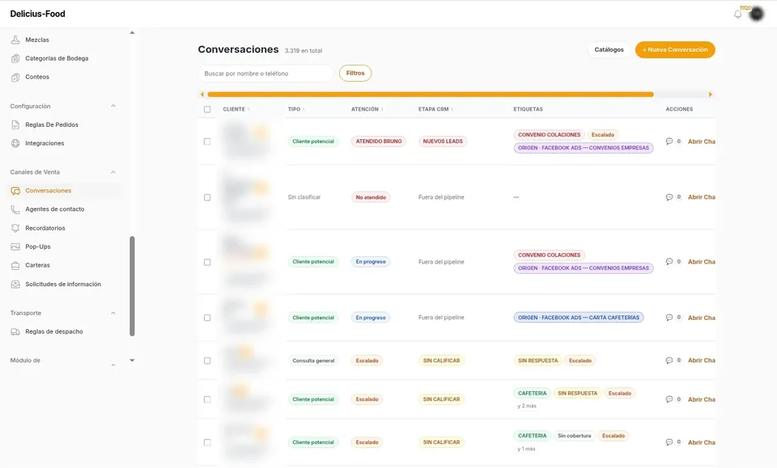
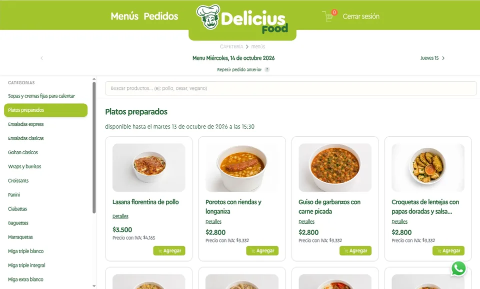
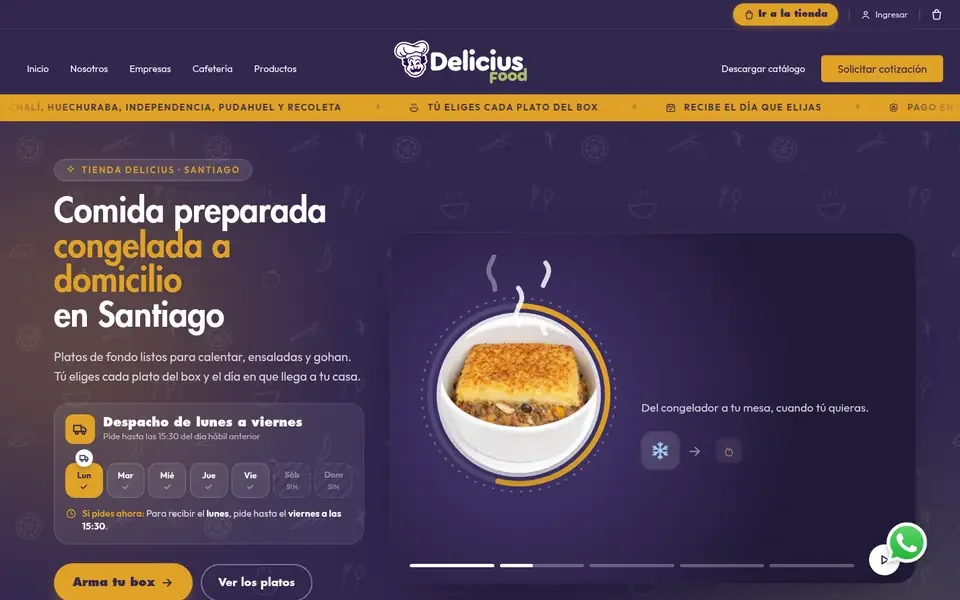

<h1 align="center">Joel Suárez</h1>

  <b>Arquitecto de software</b> · Laravel · React · AWS · DDD · Agentes de IA para WhatsApp 
  Mérida, Venezuela · 100 % remoto · Construyo software en producción desde 2017

  
  
  
  

Diseño y construyo sistemas que operan negocios reales: backoffices, tiendas, pasarelas de pago, integraciones con ERP y agentes de IA que atienden por WhatsApp. Antes de escribir código dibujo la arquitectura por capas, y la sostengo con pruebas automáticas.

He entregado sistemas para empresas de **Chile, Colombia, Estados Unidos y Francia**.

---

## 🏗️ Lo que construí para Delicius Food (Chile)

Diseñé desde cero, y sigo desarrollando, los tres sistemas que operan la empresa. El código es privado.

  
  
  

| Sistema | Qué hace | Stack |
|---|---|---|
| **Backoffice y CRM** | El centro de todo: pedidos, producción, inventario, facturación y las conversaciones de WhatsApp. Desde aquí se administran las dos tiendas. Una IA califica cada contacto, lo etiqueta según su origen (Google Ads, Meta o la web) y avisa al asesor. | Laravel 12 · Filament · DDD · DeepSeek · AWS |
| **Tienda B2B** · [pedidosdelicius.cl](https://pedidosdelicius.cl) | Las empresas con convenio eligen el día de entrega, ven el menú con sus precios y piden antes de la hora límite. | React · TypeScript · Tailwind · API en Laravel |
| **Tienda B2C y sitio web** · [deliciusfoodchile.cl](https://www.deliciusfoodchile.cl) | Boxes de comida a domicilio con pago por Klap, ingreso con Google y cada venta medida con GA4 y el Pixel de Meta. | Astro · React · Klap · GA4 · AWS |

**3.300+** conversaciones de WhatsApp · **28** empresas convertidas desde el chat · **250+** clases de test · facturación en **Defontana**

---

## 🚀 Proyectos propios

### [DDD Diagram Editor](https://github.com/thirty33/ddd-diagram-editor)
Dibuja la arquitectura de una funcionalidad, anillo por anillo y archivo por archivo, antes de programarla. Cada tarjeta es un archivo real con su diff propuesto. El editor trae un **servidor MCP**: tu agente de IA lee el diagrama y lo respeta como contrato.
`PHP` `Laravel` `React` `MCP` `DDD`

### [Atomic Habits Manager](https://github.com/thirty33/atomic-habits-manager)
SaaS de hábitos basado en el método de James Clear: intención de implementación, señales y recurrencias flexibles, con un coach de IA que lee y escribe tus datos, y planes de pago.
`Laravel 12` `Vue 3` `Tailwind` `IA`

### [Verbo](https://github.com/thirty33/grammar-exercises)
Práctica de gramática inglesa: 115 unidades y más de 3.100 ejercicios, cada respuesta corregida por IA. Arquitectura DDD con bounded contexts.
`Laravel 13` `Livewire 4` `laravel/ai` `DeepSeek`

### [joelsuarez.dev](https://github.com/thirty33/joel-suarez-portfolio)
Mi sitio web: casos, servicios y contacto. Desplegado con GitHub Actions.
`Astro` `Tailwind` `GitHub Actions`

---

## 🧰 Stack

  

- **IA:** agentes con herramientas, MCP, laravel/ai, DeepSeek, OpenAI, Anthropic y Whisper.
- **Pagos e integraciones:** WhatsApp Cloud API, Klap, Stripe, Authorize.net, Binance, Defontana, Twilio y SendGrid.
- **Calidad:** TDD, PHPUnit, Playwright y Vitest, con DDD y arquitectura hexagonal.

---

## 💼 Trayectoria

| Años | Empresa | Lo que hice |
|---|---|---|
| 2024 – hoy | **Delicius Food** · Chile | Arquitectura y desarrollo de todo el sistema (arriba) |
| 2024 – 2025 | **ST37** · Francia | Skouting y Engarde: búsqueda con IA, créditos por consumo y Stripe |
| 2022 – 2024 | **Novateva** · EE. UU. | loanofficer.ai: CI/CD, AWS y TDD (95 % menos errores en la facturación) |
| 2021 – 2022 | **Linktic** · Colombia | Logística de las elecciones de 2022: 100.000+ usuarios y 10 M de solicitudes al día |
| 2019 – 2021 | **Siesa** · Colombia | Tiendas B2B y B2C e integraciones con pasarelas de pago |

<b>¿Tienes un proceso que todavía se hace a mano?</b> <a href="https://joelsuarez.dev">Conversemos →</a>

