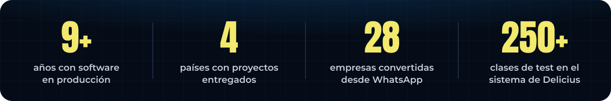
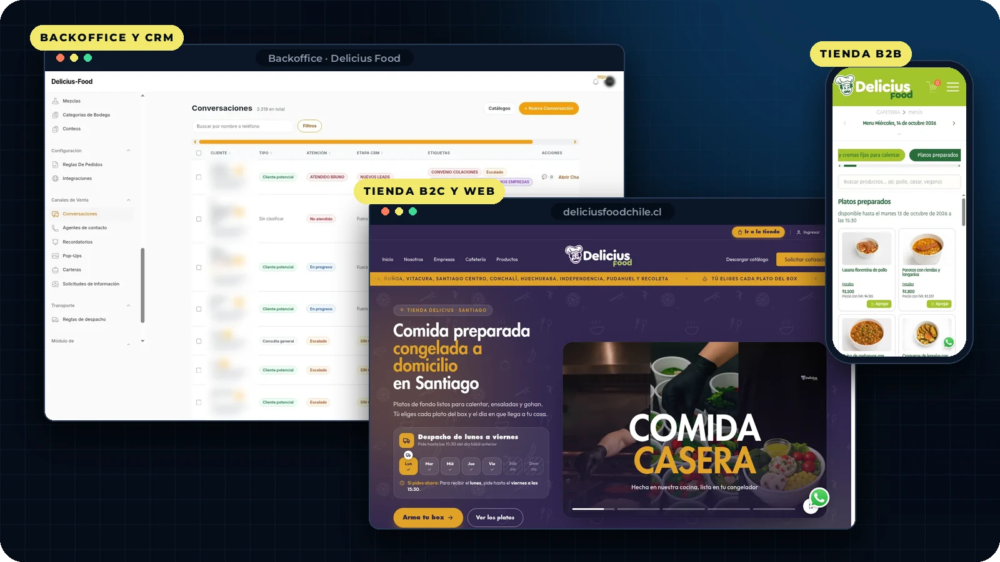
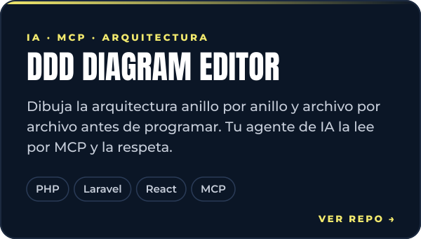
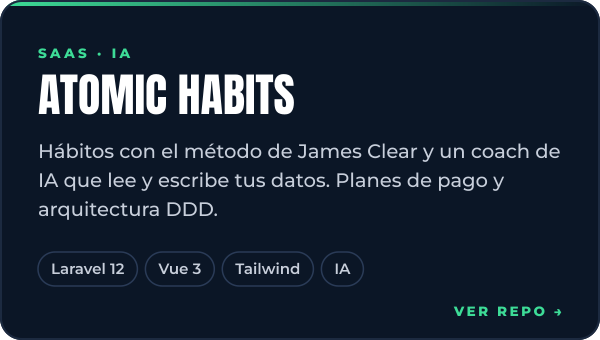
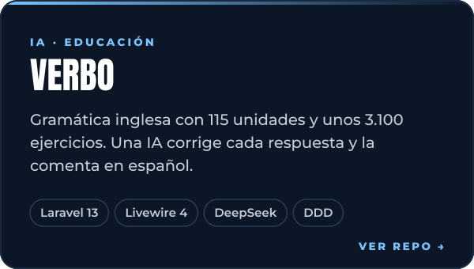
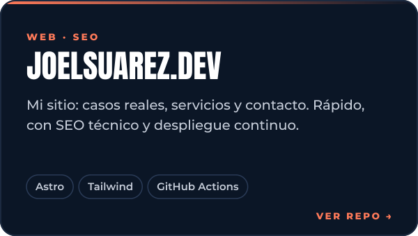
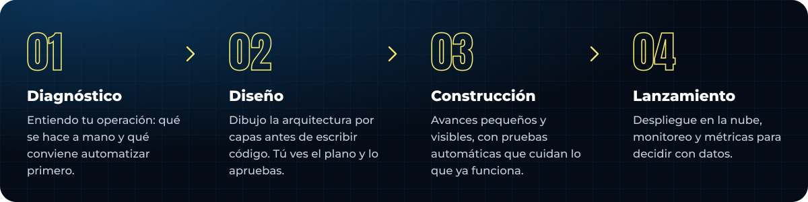
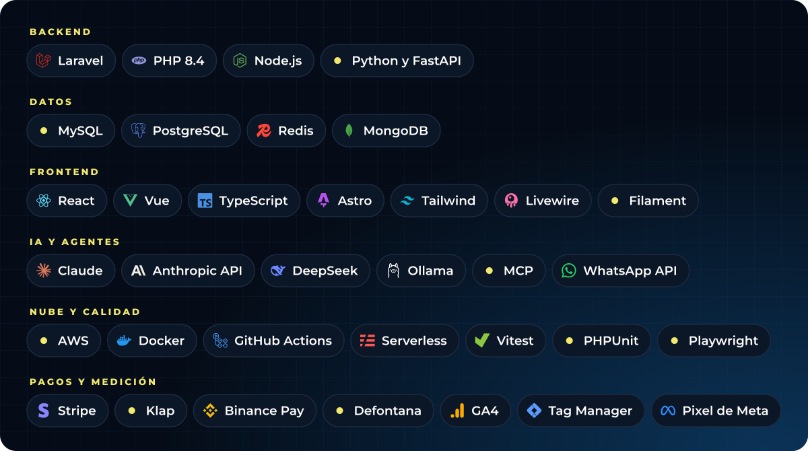

  
  
  
  

  Diseño y construyo sistemas que operan negocios reales: backoffices, tiendas, pagos en línea, integraciones con ERP y agentes de IA que atienden por WhatsApp. 
  Antes de escribir código dibujo la arquitectura por capas, y la sostengo con pruebas automáticas.

## <code>01</code> Lo que construí para Delicius Food · Chile

Diseñé desde cero, y sigo desarrollando, los tres sistemas que operan la empresa. El código es privado; esto es lo que hacen.

| Sistema | Qué hace |
|:--|:--|
| **Backoffice y CRM** | El centro de todo: pedidos, producción, inventario, facturación y las conversaciones de WhatsApp. Desde aquí se administran las dos tiendas. Una IA califica cada contacto, lo etiqueta según su origen (Google Ads, Meta o la web) y avisa al asesor. `Laravel 12` `Filament` `DDD` `DeepSeek` `AWS` |
| **Tienda B2B** [pedidosdelicius.cl](https://pedidosdelicius.cl) | Las empresas con convenio eligen el día de entrega, ven el menú con sus precios y piden antes de la hora límite. `React` `TypeScript` `Tailwind` `API en Laravel` |
| **Tienda B2C y web** [deliciusfoodchile.cl](https://www.deliciusfoodchile.cl) | Boxes de comida a domicilio con pago por Klap, ingreso con Google y cada venta medida con GA4 y el Pixel de Meta. `Astro` `React` `Klap` `GA4` `AWS` |

**3.300+** conversaciones de WhatsApp · facturación automática en **Defontana** · pagos con **Klap** · **+194 %** de clics orgánicos en dos semanas.

## <code>02</code> Proyectos propios

  
  

  
  

## <code>03</code> Cómo trabajo

## <code>04</code> Stack

## <code>05</code> Trayectoria

| Empresa | Lo que hice |
|:--|:--|
| **Delicius Food** · Chile 2024 – hoy · remoto | Arquitectura y desarrollo de todo el sistema: backoffice, tiendas B2B y B2C, WhatsApp con IA, Klap y Defontana. |
| **ST37** · Francia 2024 – 2025 · remoto | Skouting y Engarde: búsqueda con IA en lenguaje natural, créditos por consumo de IA y suscripciones con Stripe. |
| **Novateva** · EE.&nbsp;UU. 2022 – 2024 | loanofficer.ai: CI/CD, autoescalado en AWS y TDD, con 95 % menos errores en la facturación mensual. |
| **Tech4Tms** · EE.&nbsp;UU. 2022 | CRM de inventarios desde cero para empresas de logística. |
| **Linktic** · Colombia 2021 – 2022 · remoto | Logística de las elecciones de 2022: 100.000+ usuarios y 10 M de solicitudes al día, con 99,3 % de éxito. |
| **Siesa** · Colombia 2019 – 2021 | Tiendas B2B y B2C e integraciones con pasarelas de pago y transportadoras. |

